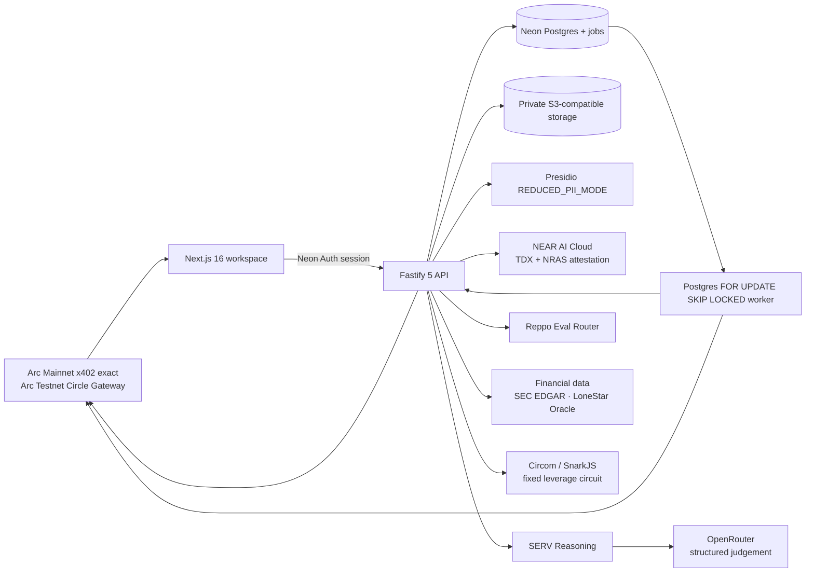

#  Assay


**AI-assisted covenant monitoring for credit teams.** The model interprets, deterministic code calculates, ZK proofs verify compliance without exposing figures, and a human approves.

[Live app](https://assay-uhhh2.vercel.app) · [Demo video](https://github.com/onyebuchidaniel60/Assay/releases/download/demo-final-2026-11-21/assay-demo-final.mp4) · [Docs](docs/)

---

## Try it — demo accounts

The app is invite-only and contains **synthetic data only**. Sign in with any of these:

| Role | Email | Password | What you can do |
|---|---|---|---|
| **Analyst** | `analyst@assay.test` | `AnalystDemo2026!` | Upload agreements, review redactions, confirm terms, enter financials, calculate, generate proofs |
| **Manager** | `manager@assay.test` | `ManagerDemo2026!` | Review the restricted compliance summary and approve/reject eligible runs |
| **Auditor** | `auditor@assay.test` | `AuditorDemo2026!` | Inspect the signed audit chain and verify events |

**Fastest path to see it work:** sign in as **Analyst** → open a pre-seeded borrower (e.g. **BOR-018**) → you'll see a completed run with a verified ZK proof and a manager approval in the audit trail.

**To walk the full workflow:** sign in as Analyst in one browser, sign in as Manager in a second incognito window, then submit an analysis and approve it.

> These accounts are seeded fixtures for evaluation. No real borrower data exists in this deployment.


**Covenant operations with evidence, deterministic arithmetic, proof-backed controls and human approval.**

<br clear="left" />

Credit teams still reconcile maximum-leverage covenants across PDFs, spreadsheets and email. Generic AI can summarize a clause, but it cannot be trusted to do the arithmetic, preserve the evidence trail, or decide whether a manager may approve. Assay makes that workflow explicit and auditable using synthetic data only.

## The problem

A single maximum Debt / Adjusted EBITDA covenant requires an analyst to find the right clause, confirm definitions and permitted add-backs, attest the financial figures, calculate leverage and stress cases, and hand a manager a decision they can defend. Most tools compress that into a chat answer with no source binding, no arithmetic control and no approval evidence.

## Who it is for

Credit analysts, credit managers and auditors at a lender or credit fund who need a reviewable covenant workflow. The demonstration uses a synthetic workspace; it is not a production credit decision system.

## What it does

1. **Create a synthetic borrower and facility.** A per-borrower data key and a signed audit chain are created transactionally.
2. **Upload a text-based PDF or TXT agreement.** Assay validates magic bytes, size and page count, rejects scanned or password-protected PDFs, encrypts the bytes and writes only ciphertext to private object storage.
3. **Review redaction.** Presidio runs in a deliberately reduced profile; the analyst confirms the redacted text before any model call.
4. **Extract one covenant.** NEAR AI Cloud extracts a single maximum Debt / Adjusted EBITDA covenant from redacted text. Every request verifies the TEE-verifiable model, fresh Intel TDX and NVIDIA NRAS evidence, nonce binding, the response ECDSA signature and request/response hashes. SERV Reasoning gates the structured branch; the analyst confirms terms and source quotes.
5. **Attest financial inputs.** Total debt, reported EBITDA and permitted add-backs are converted to integer minor units, sealed under the borrower DEK and hashed.
6. **Calculate deterministically.** Decimal arithmetic and an independent BigInt verifier produce the baseline and two stress scenarios. A fixed Groth16 circuit proves the baseline inequality when compliant.
7. **Approve with maker-checker control.** The manager sees a restricted view with no raw amounts or named counterparties. The server re-locks the run and re-verifies the stored proof before one decision is written.
8. **Verify the audit chain.** Per-borrower events are encrypted, hash-chained and Ed25519-signed. The chain remains verifiable after a demo crypto-shred.
9. **Evaluate synthetic feedback.** An analyst correction can be submitted to Reppo as a de-identified field-level trace. The real verdict is displayed; Reppo never approves the covenant.
10. **Retrieve external financial evidence.** A deterministic planner proposes a genuine evidence need. The analyst can retrieve free SEC EDGAR public-company facts or request a paid provider quote. Paid quotes are evaluated by the Arc/Circle Gateway spending policy before any signature; evidence is encrypted, source-linked, hashed and audited. Public-company data is never treated as proof of a private borrower's position.

## Architecture



- **Deterministic code owns** arithmetic, business rules, approval checks, audit verification, spending policy and payment-state transitions.
- **No LLM can calculate authoritatively, approve a credit decision or pay.**
- **Postgres is the queue.** No Redis, Kafka or Kubernetes.
- **Provider failures are visible.** There is no fabricated verdict, receipt, transfer or proof.
- **A policy approval is not a payment receipt.** Settlement requires a verifiable provider receipt or a reconciled Gateway transfer.
- **Arc Mainnet uses standard onchain x402 exact.** The authorization is signed as a USDC EIP-3009 transfer and settled by the seller facilitator. Arc Testnet/Circle Gateway remains a separate adapter.

## Live proof

Assay's production workspace completed one real, bounded external-data purchase on **Arc Mainnet**:

| Item | Value |
|---|---|
| Provider | LoneStar Oracle EquityScope (`AAPL`) |
| Amount | **0.05 USDC** (50,000 atomic units) |
| Network | Arc Mainnet, `eip155:5042` |
| Payment scheme | x402 `exact`, USDC EIP-3009 |
| Payer | `0xDff5469Ee2DD3f600ED5e216AD89705A08a85491` |
| Recipient | `0xeF2a4B6756895aAf1374640dcFCD4947959442ab` |
| Transaction | [`0xc0a9997fae6db0049622555905b59cb2c9585ab17b8825051e3f260538a9e134`](https://explorer.arc.io/tx/0xc0a9997fae6db0049622555905b59cb2c9585ab17b8825051e3f260538a9e134) |
| Result | `CONFIRMED`; provider receipt `success: true`; retrieved Apple fundamentals stored as encrypted evidence |
| Audit | Chain verification `VALID:32`, including proposed, authorized, confirmed and evidence-retrieved events |

Full evidence: [docs/evidence/payments-2026-11-20/EVIDENCE.md](docs/evidence/payments-2026-11-20/EVIDENCE.md). The spending session cap was exactly 50,000 atomic units, so a second payment is impossible without an explicit operator change. Execution is disabled again after the single authorized payment.

## Track declaration

- **PRIMARY: Open Track**
- **SECONDARY: Reppo** — feedback evaluation is live (one real synthetic evaluation completed: score 98, decision `accept`, confidence `low`, route `review`).
- **SECONDARY: Arc Mainnet x402 exact** — a real **0.05 USDC** payment to LoneStar Oracle settled on Arc Mainnet (`eip155:5042`) using standard onchain x402 `exact` and USDC EIP-3009. The transaction, provider receipt, retrieved data and audit events are recorded in [docs/evidence/payments-2026-11-20/EVIDENCE.md](docs/evidence/payments-2026-11-20/EVIDENCE.md). Deterministic allowlists, caps, expiry, idempotency, duplicate-nonce and reconciliation controls remain in force; the session cap was exactly one payment. The separate Arc Testnet/Circle Gateway adapter is preserved.
- **SECONDARY: SEC EDGAR** — free public XBRL company facts are implemented with provenance, validation and limitations. This development host received HTTP 403 from SEC/Akamai; the deployed Render egress also returned 403 during the earlier probe. No SEC result is fabricated, and the external-evidence workflow now demonstrates a live paid provider instead.
- **NOT CLAIMED: Dolphin** — evaluated and rejected because its confidentiality mechanism is unverified: no TEE, no MPC and no verified zero-retention guarantee. No Dolphin adapter, key, endpoint or model is present.

## Security and privacy summary

- Synthetic data only; invite-only accounts; public sign-up disabled at Neon Auth.
- Documents, financial snapshots, scenario details, redaction objects and audit payloads are encrypted with AES-256-GCM under a per-borrower DEK wrapped by a server-side KEK.
- Private object storage holds ciphertext only. No plaintext temporary files.
- Uploaded content is treated as hostile, untrusted data. Extraction uses strict schemas, page/quote validation and a single bounded repair attempt.
- NEAR AI receives only redacted agreement text. Each extraction is bound to fresh, nonce-bound Intel TDX and NVIDIA NRAS attestation and a signed provider response.
- OpenRouter receives structured, already-extracted data only.
- Presidio is a **reduced-model profile**, not full-strength Presidio; analyst review remains mandatory.
- The proof proves the fixed compliance predicate over the submitted witness, not the truth of the source figures.
- The audit chain is signed and tamper-evident; it is not claimed immutable against a fully compromised signing key.
- Reppo receives only field-level, de-identified correction traces, never agreement text, borrower identity, token maps or raw financial figures.
- The Arc payer private key is server-side only, held in non-serialisable private fields, never stored in the database, never sent to the frontend and never logged. Payment execution is disabled by default and was disabled again immediately after the single authorized Mainnet payment.
- External evidence is encrypted with the borrower DEK, content-hashed and linked to the run. SEC/public-company limitations are shown explicitly.
- Kite Passport, Kite SDKs, `PIEUSD`, `gokite.ai` and Kite credentials are removed from the active application.

## Quick start

Prerequisites: Node.js 24 LTS, pnpm 10.34.5, Python 3.12 for Presidio, Circom 2.x and SnarkJS for circuit setup. Neon provides Postgres and managed Better Auth.

```bash
git clone https://github.com/onyebuchidaniel60/Assay.git
cd Assay
pnpm install --frozen-lockfile
cp .env.example .env.local   # fill development/test values only; never commit
pnpm --filter @assay/db migrate
pnpm --filter @assay/api dev
pnpm --filter @assay/web dev
```

- Web: `http://localhost:3000`
- API: `http://localhost:3001`
- Presidio: see [docs/SETUP.md](docs/SETUP.md)
- Proof artifacts: `packages/proof/artifacts/`

See [docs/CONFIGURATION.md](docs/CONFIGURATION.md) for every variable and [docs/SETUP.md](docs/SETUP.md) for the exact verified setup. Payment execution is off by default; see [docs/PAYMENTS_ARCHITECTURE.md](docs/PAYMENTS_ARCHITECTURE.md) before configuring any payer wallet.

## Verified deployment

- **Production:** `https://assay-omega-gray.vercel.app` and stable alias `https://assay-uhhh2.vercel.app` (public; invite-only app sign-in)
- **Deployed commits:** frontend UI `b8853e9`; Render API `720f9a1`
- **API health:** `https://assay-api-7hy0.onrender.com/health/live`
- **Presidio:** `https://assay-presidio.onrender.com/health`
- **Demo video:** [public release asset](https://github.com/onyebuchidaniel60/Assay/releases/download/demo-final-2026-11-21/assay-demo-final.mp4) · [local copy](docs/demo/assay-demo-final.mp4)
- **Repository:** `https://github.com/onyebuchidaniel60/Assay`
- **Live payment evidence:** [docs/evidence/payments-2026-11-20/EVIDENCE.md](docs/evidence/payments-2026-11-20/EVIDENCE.md)

The production deployment is public; the workspace itself requires an invited synthetic account. Payment execution is disabled and the one authorized session is fully spent. The public API health endpoint is available for availability checks; the demo video is the primary public walkthrough.

## Documentation

- [Setup](docs/SETUP.md)
- [Configuration](docs/CONFIGURATION.md)
- [API reference](docs/API.md)
- [Data model](docs/DATA_MODEL.md)
- [Security architecture](docs/SECURITY.md)
- [Integrations](docs/INTEGRATIONS.md)
- [Arc payments and external evidence](docs/PAYMENTS_ARCHITECTURE.md)
- [Testing and evidence](docs/TESTING.md)
- [Deployment](docs/DEPLOYMENT.md)
- [Operator guide](docs/OPERATOR_GUIDE.md)
- [Troubleshooting](docs/TROUBLESHOOTING.md)
- [Design notes](docs/DESIGN_NOTES.md)
- [Research notes](docs/RESEARCH_NOTES.md)
- [Build log](docs/BUILD_LOG.md)
- [Submission write-up](docs/SUBMISSION.md)
- [Live payment evidence](docs/evidence/payments-2026-11-20/EVIDENCE.md)
- [Final demo script](docs/demo/assay-demo-script.md) · [storyboard](docs/demo/assay-demo-storyboard.md) · [production notes](docs/demo/assay-demo-production-notes.md)
- [Complete implementation blueprint](MASTER_BLUEPRINT.md)

## Project status

Phases 1–9 are complete. The 20–21 November 2026 release replaces Kite with two Arc payment adapters, adds encrypted external-evidence linkage, and completed one real **0.05 USDC** Arc Mainnet x402 payment with a verified LoneStar Oracle retrieval. The production backend is Render; the frontend is Vercel. Payment execution is disabled after the single authorized payment. See [docs/evidence/payments-2026-11-20/EVIDENCE.md](docs/evidence/payments-2026-11-20/EVIDENCE.md), [AI_HANDOFF.md](AI_HANDOFF.md) and [docs/BUILD_LOG.md](docs/BUILD_LOG.md). The final demo video replaces the earlier historical artifact.

## License and attribution

No open-source license has been selected by the repository owner; do not redistribute the repository or assets without permission. The Assay logo is operator-supplied and committed at `apps/web/public/brand/assay-logo.png`. The four AVIF design inspiration references under `design/reference/` are licensed inspiration only, are Git-ignored, and are not redistributed. Third-party libraries retain their own licenses; see lockfiles and package metadata.
