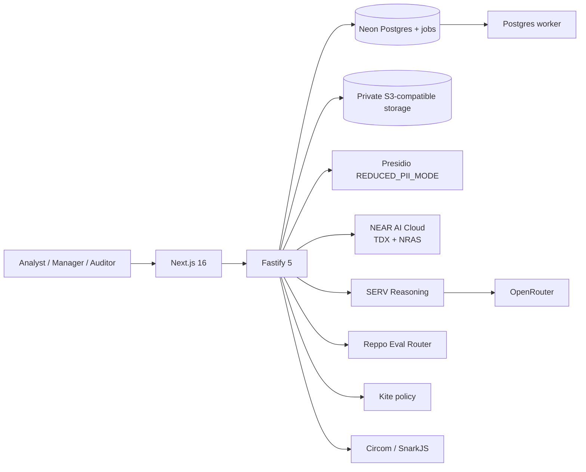

# Assay — Submission

## One-line description

Assay turns a maximum Debt / Adjusted EBITDA covenant into an evidence-linked, deterministic and proof-backed decision that a manager can actually defend.

## Problem

Credit teams still reconcile covenants across PDFs, spreadsheets and email. A generic AI answer can summarize a clause, but it cannot be trusted to do the arithmetic, preserve source evidence, protect borrower data or decide whether a manager may approve. The missing piece is not another chat interface; it is an accountable workflow.

## Who it is for

Credit analysts, credit managers and auditors at lenders and credit funds. Assay is demonstrated with synthetic data only and is not a production credit decision system.

## What it does

1. Creates a synthetic borrower/facility with a per-borrower key and signed audit chain.
2. Encrypts a text-based PDF/TXT agreement before private object storage.
3. Runs a reduced-model Presidio profile and requires analyst redaction review before inference.
4. Extracts exactly one maximum leverage covenant with page/quote evidence. Every NEAR AI extraction is checked against fresh Intel TDX and NVIDIA NRAS attestation, nonce binding, model identity and the response ECDSA signature.
5. Uses SERV Reasoning as a core bounded node for extraction routing and calculation coherence; OpenRouter handles structured judgement/generation only.
6. Seals analyst-attested financial inputs, calculates baseline and two stress cases deterministically, and verifies the arithmetic independently.
7. Generates and server-verifies a fixed-circuit Groth16 proof for a compliant baseline.
8. Re-verifies the stored proof at manager approval, then records one maker-checker decision bound to the exact analysis version and proof.
9. Keeps a per-borrower encrypted, hash-chained, Ed25519-signed audit trail that remains verifiable after demo crypto-shred.
10. Submits optional synthetic correction traces to Reppo and displays the real verdict.

## How SERV Reasoning is used

SERV is not decorative. Assay calls SERV twice in the core workflow:

- **Extraction gate:** after NEAR AI returns schema-validated terms, SERV receives structured facts (covenant type, comparator, threshold, evidence count, confidence, uncertainty notes, add-back count) and chooses `SUPPORTED_CLEAR`, `ANALYST_REVIEW_REQUIRED` or `UNSUPPORTED_COVENANT`. An unsupported covenant stops the run.
- **Calculation gate:** after deterministic baseline/stress results, SERV receives non-identifying classifications and headroom bands and must confirm coherence. Disagreement stops the run as `SERV_DISAGREEMENT`; unavailability leaves the run in `CALCULATED_SERV_PENDING` rather than claiming SERV completion.

SERV never does arithmetic, approves a run, changes policy or writes the database. The application owns the state machine.

## Track declaration

- **PRIMARY: Open Track**
- **SECONDARY: Reppo** — LIVE. A real synthetic evaluation completed: provider eval `cmwikqtsn000f08l4y73d9a8m`, score 98/100, decision `accept`, confidence `low`, route `review`, 440 credits, 409-byte safe trace. The legacy Reppo endpoints were removed by the provider; Assay uses the live `/agents/evals` endpoints and records the deviation.
- **SECONDARY: Kite** — the deterministic session/cap/asset/expiry policy and over-cap rejection are implemented. Payment is **provider-blocked**: the first documented testnet service returned an upstream internal error; the second documented endpoint (`x402.dev.gokite.ai/api/weather`) did not resolve (DNS `ENOTFOUND`) on 16 November 2026. No successful payment is claimed.
- **NOT CLAIMED: Dolphin** — evaluated and rejected. Its confidentiality mechanism is unverified: no TEE, no MPC, zero-retention unverified. No Dolphin adapter, endpoint, key or flag exists in the repository.

## Architecture

## Privacy and security summary

- Synthetic data only; invite-only accounts; public sign-up disabled.
- AES-256-GCM under a per-borrower DEK wrapped by a server-only KEK; ciphertext-only private storage.
- Reduced-model Presidio profile with mandatory analyst review; no full-strength claim.
- NEAR AI receives only redacted text and returns attestation-bound output; OpenRouter receives structured, already-extracted data.
- ZK proof covers the defined leverage predicate, not the truth of the source figures.
- Audit chain is signed and tamper-evident, not immutable against a fully compromised key.
- Reppo receives only field-level de-identified correction traces; no agreement text, borrower identity, token map or raw amounts.
- No `zero retention guaranteed`, `TEE protected` without `attested`, `GDPR compliant` or differential-privacy claims.

## Links

- **Repository:** https://github.com/onyebuchidaniel60/Assay
- **Demo video:** `[YouTube unlisted / Drive URL — pending upload]`
- **Public API health:** https://assay-api-7hy0.onrender.com/health/live
- **Preview:** https://assay-uhhh2.vercel.app — protected by Vercel Authentication; interactive access requires an invited synthetic account. The demo video is the public walkthrough.
- **Documentation:** https://github.com/onyebuchidaniel60/Assay/tree/main/docs

## X post

> Credit teams still reconcile covenants across PDFs, spreadsheets and email. Assay turns one maximum Debt/Adjusted EBITDA covenant into an evidence-linked, deterministic and proof-backed decision a manager can defend.
>
> Redacted extraction via NEAR AI Cloud with fresh TDX/NRAS attestation, SERV Reasoning as a core gate, a fixed Groth16 compliance proof, maker-checker approval and a signed audit trail. Synthetic feedback evaluation via Reppo. Kite x402 policy is live; payment is provider-blocked.
>
> Built for @OpenServAI #SERVHackathon.
>
> Repo: https://github.com/onyebuchidaniel60/Assay
> Demo: [demo URL]
> Docs: https://github.com/onyebuchidaniel60/Assay/tree/main/docs

## Submission checklist

- [x] Public GitHub repository: https://github.com/onyebuchidaniel60/Assay
- [ ] Demo video public URL — upload pending
- [ ] Live interactive preview — protected by Vercel Authentication; documented as protected
- [x] Write-up ready (this file)
- [x] X post drafted
- [ ] X post will link to the submission — operator action
- [ ] Data collection enabled in OpenServ org settings — operator to verify
- [ ] SERV API key active and credit balance adequate — operator to verify
- [x] Reppo real evaluation completed
- [x] Kite status recorded honestly (provider-blocked)
- [x] No Dolphin claim
