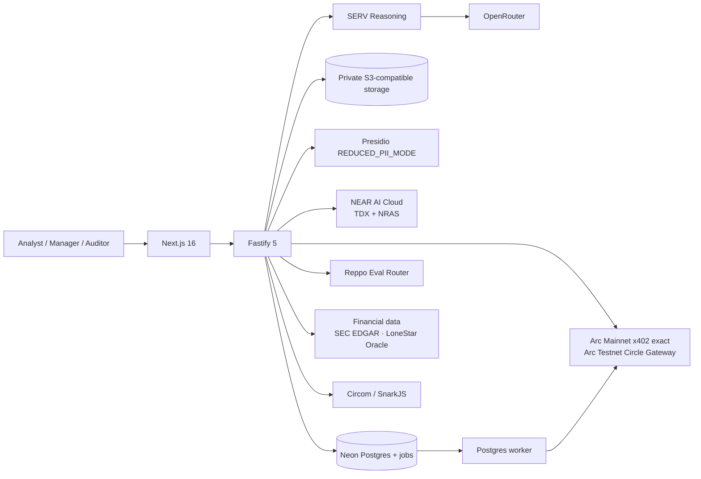

# Assay — Submission

## One-line description

Assay turns a maximum Debt / Adjusted EBITDA covenant into an evidence-linked, deterministic and proof-backed decision that a manager can actually defend.

## Problem

Credit teams still reconcile covenants across PDFs, spreadsheets and email. A generic AI answer can summarize a clause, but it cannot be trusted to do the arithmetic, preserve source evidence, protect borrower data or decide whether a manager may approve. The missing piece is not another chat interface; it is an accountable workflow.

## Who it is for

Credit analysts, credit managers and auditors at lenders and credit funds. Assay is demonstrated with synthetic data only and is not a production credit decision system.

## What it does

1. Creates a synthetic borrower/facility with a per-borrower key and signed audit chain.
2. Encrypts a text-based PDF/TXT agreement before private object storage.
3. Runs a reduced-model Presidio profile and requires analyst redaction review before inference.
4. Extracts exactly one maximum leverage covenant with page/quote evidence. Every NEAR AI extraction is checked against fresh Intel TDX and NVIDIA NRAS attestation, nonce binding, model identity and the response ECDSA signature.
5. Uses SERV Reasoning as a core bounded node for extraction routing and calculation coherence; OpenRouter handles structured judgement/generation only.
6. Seals analyst-attested financial inputs, calculates baseline and two stress cases deterministically, and verifies the arithmetic independently.
7. Generates and server-verifies a fixed-circuit Groth16 proof for a compliant baseline.
8. Re-verifies the stored proof at manager approval, then records one maker-checker decision bound to the exact analysis version and proof.
9. Keeps a per-borrower encrypted, hash-chained, Ed25519-signed audit trail that remains verifiable after demo crypto-shred.
10. Submits optional synthetic correction traces to Reppo and displays the real verdict.

## How SERV Reasoning is used

SERV is not decorative. Assay calls SERV twice in the core workflow:

- **Extraction gate:** after NEAR AI returns schema-validated terms, SERV receives structured facts (covenant type, comparator, threshold, evidence count, confidence, uncertainty notes, add-back count) and chooses `SUPPORTED_CLEAR`, `ANALYST_REVIEW_REQUIRED` or `UNSUPPORTED_COVENANT`. An unsupported covenant stops the run.
- **Calculation gate:** after deterministic baseline/stress results, SERV receives non-identifying classifications and headroom bands and must confirm coherence. Disagreement stops the run as `SERV_DISAGREEMENT`; unavailability leaves the run in `CALCULATED_SERV_PENDING` rather than claiming SERV completion.

SERV never does arithmetic, approves a run, changes policy or writes the database. The application owns the state machine.

## Track declaration

- **PRIMARY: Open Track**
- **SECONDARY: Reppo** — LIVE. A real synthetic evaluation completed: provider eval `cmwikqtsn000f08l4y73d9a8m`, score 98/100, decision `accept`, confidence `low`, route `review`, 440 credits, 409-byte safe trace. The legacy Reppo endpoints were removed by the provider; Assay uses the live `/agents/evals` endpoints and records the deviation.
- **SECONDARY: Arc Mainnet x402 exact — LIVE, ONE PAYMENT CONFIRMED.** A real **0.05 USDC** LoneStar Oracle `AAPL` purchase settled on Arc Mainnet (`eip155:5042`) using standard onchain x402 `exact` and USDC EIP-3009. Transaction: [`0xc0a9997fae6db0049622555905b59cb2c9585ab17b8825051e3f260538a9e134`](https://explorer.arc.io/tx/0xc0a9997fae6db0049622555905b59cb2c9585ab17b8825051e3f260538a9e134). Provider receipt `success: true`; `authorizationState` true; wallet 0.93 → 0.88 USDC; returned Apple fundamentals stored as encrypted, source-linked evidence; audit chain `VALID:32`. The production session caps were exactly 50,000/50,000 atomic units and execution was disabled immediately after settlement. The Arc Testnet/Circle Gateway adapter is preserved. Full evidence: [evidence/payments-2026-11-20/EVIDENCE.md](evidence/payments-2026-11-20/EVIDENCE.md).
- **SECONDARY: SEC EDGAR** — free public-company XBRL evidence is implemented with provenance, period validation, content hash and explicit limitations. This development host received HTTP 403 from SEC/Akamai; live retrieval must be re-probed from the deployed Render egress. No live SEC result is claimed here.
- **REMOVED: Kite** — Kite Passport is no longer an active dependency, credential, route or setup requirement. Historical provider-blocked evidence is archived at [archive/KITE_REMOVAL.md](archive/KITE_REMOVAL.md).
- **NOT CLAIMED: Dolphin** — evaluated and rejected. Its confidentiality mechanism is unverified: no TEE, no MPC, zero-retention unverified. No Dolphin adapter, endpoint, key or flag exists in the repository.

## Architecture

## Privacy and security summary

- Synthetic data only; invite-only accounts; public sign-up disabled.
- AES-256-GCM under a per-borrower DEK wrapped by a server-only KEK; ciphertext-only private storage.
- Reduced-model Presidio profile with mandatory analyst review; no full-strength claim.
- NEAR AI receives only redacted text and returns attestation-bound output; OpenRouter receives structured, already-extracted data.
- ZK proof covers the defined leverage predicate, not the truth of the source figures.
- Audit chain is signed and tamper-evident, not immutable against a fully compromised key.
- Reppo receives only field-level de-identified correction traces; no agreement text, borrower identity, token map or raw amounts.
- No `zero retention guaranteed`, `TEE protected` without `attested`, `GDPR compliant` or differential-privacy claims.

## Design references

Design reference images are used as licensed inspiration only and are not redistributed in the repository. The operator-supplied Assay logo is committed as a product asset at `apps/web/public/brand/assay-logo.png`.

## Links

- **Repository:** https://github.com/onyebuchidaniel60/Assay
- **Demo video:** https://github.com/onyebuchidaniel60/Assay/releases/download/demo-v1/assay-demo-final.mp4 (public GitHub release asset; YouTube/Drive upload requires operator OAuth)
- **Public API health:** https://assay-api-7hy0.onrender.com/health/live
- **Production:** https://assay-uhhh2.vercel.app — public landing and login; the workspace requires an invited synthetic account. Production domain: https://assay-omega-gray.vercel.app. Demo credentials are supplied separately through the operator channel.
- **Documentation:** https://github.com/onyebuchidaniel60/Assay/tree/main/docs

## X post

> Credit teams still reconcile covenants across PDFs, spreadsheets and email. Assay turns one maximum Debt/Adjusted EBITDA covenant into an evidence-linked, deterministic and proof-backed decision a manager can defend.
>
> Redacted extraction via NEAR AI Cloud with fresh TDX/NRAS attestation, SERV Reasoning as a core gate, a fixed Groth16 compliance proof, maker-checker approval and a signed audit trail. Synthetic feedback evaluation via Reppo. Arc Mainnet x402 exact completed a real 0.05 USDC LoneStar Oracle purchase: the transaction, provider receipt, EIP-3009 authorization state, retrieved Apple fundamentals and VALID:32 audit chain are public evidence. Arc Testnet/Circle Gateway remains available as a separate adapter.
>
> Built for @OpenServAI #SERVHackathon.
>
> Repo: https://github.com/onyebuchidaniel60/Assay
> Demo: https://github.com/onyebuchidaniel60/Assay/releases/download/demo-v1/assay-demo-final.mp4
> Docs: https://github.com/onyebuchidaniel60/Assay/tree/main/docs

## Submission checklist

- [x] Public GitHub repository: https://github.com/onyebuchidaniel60/Assay
- [x] Demo video public URL — GitHub release asset (YouTube/Drive upload requires operator OAuth)
- [x] Live production deployment verified at `720f9a1` — public URL; app-level invite-only sign-in; live Arc Mainnet payment and retrieval verified
- [x] Write-up ready (this file)
- [x] X post drafted
- [ ] X post will link to the submission — operator action
- [ ] Data collection enabled in OpenServ org settings — operator to verify
- [ ] SERV API key active and credit balance adequate — operator to verify
- [x] Reppo real evaluation completed
- [x] Arc Mainnet x402 exact live payment + Arc Testnet Gateway adapter recorded honestly
- [x] SEC EDGAR host-level 403 recorded; no live result fabricated
- [x] No Dolphin claim
